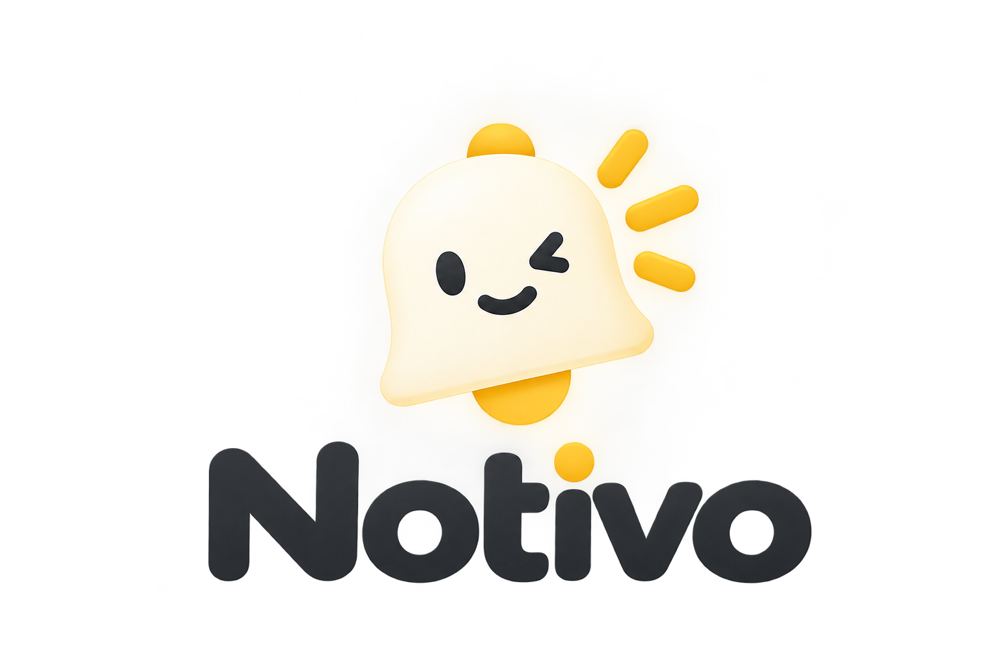

# Notivo — Focus, Habit & Hydration Tracker

<p align="center">
  
</p>

<p align="center">
  <strong>Notivo</strong> is a modern, privacy-first personal productivity and health web app inspired by the clean, minimal Crextio aesthetic (Warm Yellow & Deep Ink). It empowers you to balance deep work, daily habits, future goals, and mindful hydration in one unified dashboard.
</p>

<p align="center">
  <a href="#key-features">Key Features</a> •
  <a href="#tech-stack">Tech Stack</a> •
  <a href="#getting-started">Getting Started</a> •
  <a href="#project-structure">Project Structure</a> •
  <a href="#deployment">Deployment</a>
</p>

---

## 🌟 Key Features

### 📊 1. Insightful Dashboard
- **Focus & Hydration Analytics**: Interactive bar charts powered by Recharts with Monday-aligned weekly view.
- **Real-time Metrics**: At-a-glance focus time, water consumption, task completion rate, and goal progress.
- **Branded PDF Export**: Download beautiful, printable backup reports with the Notivo brand logo and footer attribution.
- **Safe Data Management**: Reset data safely with customized confirmation dialogs.

### ⏱️ 2. Deep Work & Pacing Timers
- **Focus Sessions**: Study interval pacing with custom durations and break intervals.
- **Live Tracking**: Automatic session history logging with real-time active session duration tickers.
- **Away-Time Detection**: Intelligently prompts you to keep or fix session end times when returning from sleep or inactive tabs.

### 💧 3. Mindful Hydration Tracker
- **12-Glass Daily Target**: Track daily water intake with visual liquid waves and floating bubbles.
- **Smart Reminders**: Configurable browser notification intervals to stay hydrated throughout the day.
- **Historical Logs**: Tracks daily hydration habits over time.

### ✅ 4. Daily Tasks & Habits
- **Daily Focus List**: Set essential daily habits with one-click completion.
- **Bulk Actions**: One-click "Clear All Tasks" with a confirmation popup.
- **Automated Morning & Evening Reminders**: Get notified to plan your day in the morning and reflect in the evening.

### 🎯 5. Goals & Future Milestones
- **Time-Sensitive Milestones**: Schedule upcoming deadlines and important milestones.
- **Smart Categorization**: Automatically groups goals into *Today*, *Upcoming*, *Missed*, and *Done*.
- **Confirmation Modals**: Delete individual goals or clear all with custom glassmorphism modal dialogs.

### 🎨 6. UI & Design System
- **Crextio Aesthetic**: Minimalist yellow `#FFD84D` and ink `#1C1C1E` design language.
- **Live Digital Clock**: Compact digital clock widget in the topbar and home page.
- **Interactive Calendar**: Clean monthly calendar widget with week numbers and day indicators.
- **Dark & Light Mode**: Instant toggle with theme persistence.
- **Privacy First**: 100% local storage. Your data stays completely on your device.

---

## 🛠️ Tech Stack

- **Framework**: [React 19](https://react.dev/) + [Vite 8](https://vitejs.dev/)
- **Routing**: [React Router DOM v7](https://reactrouter.com/)
- **Charts**: [Recharts](https://recharts.org/)
- **PDF Generation**: [jsPDF](https://github.com/parallax/jsPDF)
- **Icons**: [Lucide React](https://lucide.dev/)
- **Linter**: [Oxlint](https://oxc.rs/)

---

## 🚀 Getting Started

### Prerequisites
- [Node.js](https://nodejs.org/) (version 18+ recommended)
- `npm` or `pnpm` / `yarn`

### Installation

1. **Clone the repository:**
   ```bash
   git clone https://github.com/your-username/notivo.git
   cd notivo
   ```

2. **Install dependencies:**
   ```bash
   npm install
   ```

3. **Start the development server:**
   ```bash
   npm run dev
   ```
   Open `http://localhost:5173` in your browser.

4. **Build for production:**
   ```bash
   npm run build
   ```

5. **Preview production build:**
   ```bash
   npm run preview
   ```

---

## 📂 Project Structure

```
notivo/
├── public/                 # Static assets & redirects
├── src/
│   ├── assets/             # Brand icons & wordmarks (Notivo.png, NotivoWordmark.png)
│   ├── components/         # Reusable UI components (ConfirmModal, TaskList, etc.)
│   ├── context/            # Global AppContext state provider
│   ├── hooks/              # Custom React hooks (useStudyTimer, useGoals, useWaterReminder, etc.)
│   ├── pages/              # Main route views (Dashboard, Home, Study, Tasks, Goals, Water)
│   ├── utils/              # Utility helpers (pdfExport, studyUtils, time)
│   ├── App.css             # Crextio design tokens & responsive styling
│   ├── App.jsx             # Topbar navigation, routes & shell
│   └── main.jsx            # React root mount
├── .gitignore              # Git ignore rules
├── index.html              # HTML entry point with Google Fonts
├── package.json            # Scripts & dependencies
├── vercel.json             # Vercel SPA routing config
└── vite.config.js          # Vite build config
```

---

## 🌐 Deployment

The project includes SPA routing support for Vercel (`vercel.json`) and Netlify (`public/_redirects`).

### Deploy to Vercel
Push your repository to GitHub, import it in Vercel, and click **Deploy**. Vercel will automatically run `npm run build` with the output directory `dist`.

---

## 📄 License

This project is open source and available under the [MIT License](LICENSE).
